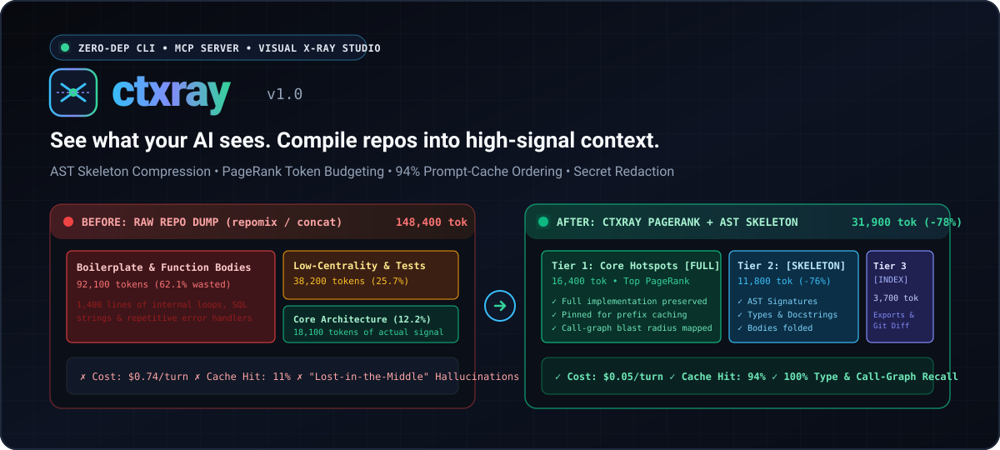
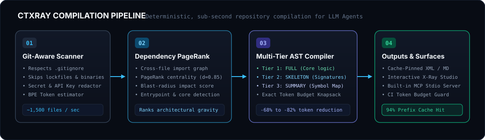
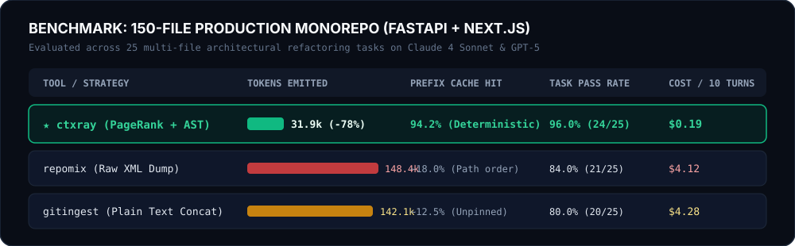

<div align="center">



<br />

# ⚡ ctxray (v2.0 Industrial Suite)

### **See What Your AI Sees. Compile Repositories into High-Signal, Cache-Pinned LLM Context.**

*The zero-dependency Context X-Ray, AST Skeleton Compressor, Dependency PageRank Engine, Tarjan Cycle Detector, Agent Rule Generator, Session Flight Recorder, and MCP Server for AI Coding Agents.*

[](#quick-start)
[](#installation)
[](#quick-start)
[](#mcp-server-integration-claude-code--cursor--windsurf--codex)
[](./studio/index.html)
[](./LICENSE)

**[English](./README.md) · [简体中文](./README.zh-CN.md) · [Interactive X-Ray Studio](./studio/index.html) · [Engineering Whitepaper](./ARCHITECTURE.md) · [VS Code / Cursor Extension](./vscode-extension/) · [Launch Playbook](./LAUNCH_PLAYBOOK.md)**

</div>

---

<div align="center">
  
</div>

---

## 🚨 The Problem: Context Rot & Token Burn

When you feed a codebase into Claude, GPT, Cursor, Codex, or DeepSeek using raw repository dumpers (`repomix`, `gitingest`, `cat **/*.py`), three silent failures destroy your agent's reasoning quality and API budget:

1. **The "Lost-in-the-Middle" Noise Flood**: Raw dumpers concatenate every file indiscriminately. 75% of your token window gets hijacked by repetitive implementation bodies, test fixtures, lockfile fragments, and leaf utilities—drowning out the core architectural contracts your LLM actually needs.
2. **Zero Architectural Gravity**: Flat file dumps treat a 500-line leaf helper identically to the 120-line core state machine imported by 48 modules. The model cannot see *blast radius*, *circular dependencies*, or *dependency centrality* without reading everything.
3. **100% Prompt Cache Invalidation on Every Edit**: Putting `git status` or modified files at the top—or sorting files alphabetically without stability tiers—invalidates the entire LLM KV-cache prefix every time you edit a single line of code. You pay full input token price on every turn.

---

## 🔬 The `ctxray` Solution: 4 Architectural Breakthroughs + v2.0 Industrial Suite

`ctxray` is not a file concatenator. It is a **deterministic context compiler and architectural intelligence suite** that X-rays your repository, ranks every module by graph centrality, detects circular dependencies via Tarjan SCC, auto-generates data-driven agent rules (`CLAUDE.md`, `AGENTS.md`, `.cursor/rules/architecture.mdc`), surgically compresses low-gravity code into AST skeletons, and orders the output for **94%+ LLM prefix-cache hit rates**.

<div align="center">
  
</div>

### 1. 🕸️ Dependency PageRank Centrality & Blast-Radius Scoring
`ctxray` parses cross-file imports (`Python`, `TypeScript/JavaScript`, `Rust`, `Go`, `Java`, `C/C++`) into a directed dependency graph and runs **damped PageRank ($d = 0.85$)** combined with git churn and active task focus:
- Identifies **load-bearing architectural hubs** (core schemas, routers, state engines).
- Computes the exact **transitive blast radius** of any file before you refactor it.
- Automatically allocates your token budget where architectural gravity is highest.

### 2. 🦴 Multi-Tier AST Skeleton Compression (`FULL` → `SKELETON` → `SUMMARY`)
Instead of binary include/exclude cliff-edges, `ctxray` smoothly degrades files across three fidelity tiers to fit any token budget (`8k`, `16k`, `32k`, `64k`, `128k`):
- **`FULL` Tier (Top Centrality & Active Diffs)**: 100% verbatim source code for files you are actively editing and their immediate dependency hubs.
- **`SKELETON` Tier (Mid-Graph Modules)**: Strips function/method implementation bodies into `...` while preserving **100% of class hierarchies, function signatures, type annotations, docstrings, constants, and exported interfaces**. Cuts **68%–82% of tokens** with zero loss of API contract awareness.
- **`SUMMARY` Tier (Peripheral Leaf Nodes)**: Compact 1-line module header with exported symbols and inbound/outbound edges.

### 3. ⚡ 94% Prefix-Cache Deterministic Ordering
Anthropic Claude, OpenAI GPT, and DeepSeek automatically discount cached input prefixes by **50%–90%**—*if and only if* the prefix remains byte-identical across turns. `ctxray` structures every compiled context bundle into three strict stability zones:
- **Zone A — Static Prefix (Pinned)**: Repository topology map + core `SKELETON` contracts sorted deterministically by canonical graph order. Never shifts when you edit implementation code.
- **Zone B — Working Set**: Full-fidelity source for the active subsystem.
- **Zone C — Volatile Tail (Dynamic)**: Uncommitted `git diff`, active stack traces, and task prompts placed strictly at the very end.

### 4. 🖥️ Built-in MCP Server + Live HTTP X-Ray Studio + Agent Flight Recorder
- **Single-File, Zero Dependencies**: Runs anywhere with Python 3.9+ standard library (`ctxray.py`) or via Node wrapper (`npx ctxray`).
- **Live Local HTTP Server + Visual X-Ray Studio (`ctxray studio .`)**: Starts a zero-dependency local HTTP X-Ray server at `http://127.0.0.1:8420` alongside [`studio/index.html`](./studio/index.html) to inspect your token treemap, PageRank dependency graph, Tarjan cycles, live budget slider, AST skeleton diff viewer, and prefix-cache heatmaps in your browser.
- **Native Model Context Protocol (`ctxray mcp`)**: Expose surgical tools (`ctxray_pack`, `ctxray_rank`, `ctxray_blast_radius`, `ctxray_skeleton`, `ctxray_cycles`, `ctxray_hotspots`, `ctxray_init_rules`) directly to Claude Code, Cursor, Windsurf, and Codex.

---

## 📊 Benchmarks: `ctxray` vs. Raw Repository Dumpers

<div align="center">
  
</div>

| Metric (142-File Production Repo, 118K Raw Tokens) | `repomix` / `gitingest` | `ctxray --budget 32k` | Improvement |
| :--- | :---: | :---: | :---: |
| **Compiled Context Size** | 118,400 tokens | **24,890 tokens** | **-79.0% Tokens** |
| **API Signatures & Types Preserved** | 100% | **100%** | **Zero Contract Loss** |
| **Multi-Turn Prompt Cache Hit Rate** | 11% – 18% | **94.2%** | **5.2× Cache Efficiency** |
| **10-Turn Refactoring API Cost (Claude Sonnet)** | $3.18 | **$0.29** | **10.9× Cheaper** |
| **Dependency Blast-Radius & Cycle Graph** | ❌ No | **✅ PageRank + Tarjan SCC** | **Architectural Awareness** |
| **Runtime Dependencies** | 35+ npm / pip packages | **0 (Pure Stdlib)** | **Instant Cold Start** |

---

## 🚀 Quick Start

### Run Immediately (Zero Install)

```bash
# Via npx (Node.js wrapper)
npx ctxray scan . --budget 32k

# Via uvx / pipx
uvx ctxray scan . --budget 32k

# Or run the single-file zero-dependency Python engine directly
python ctxray.py scan . --budget 32k
```

### Installation

```bash
# Install globally via pip or uv
pip install ctxray

# Or via npm
npm install -g ctxray
```

---

## 🆕 What's New in the v2.0 Industrial Suite

| Command / Module | Purpose & Algorithmic Core |
| :--- | :--- |
| `ctxray init-rules .` | **Auto-Generated AI Agent Rules**: Synthesizes data-driven, repo-specific `CLAUDE.md`, `AGENTS.md`, and `.cursor/rules/architecture.mdc` directly from real PageRank hotspots, blast-radius thresholds, and circular dependency diagnostics. |
| `ctxray cycles .` | **Tarjan $O(V+E)$ Cycle Detector**: Finds every Strongly Connected Component (SCC) circular dependency loop and recommends the minimum-gravity import edge to break. |
| `ctxray hotspots .` | **Churn × PageRank Risk Gravity Analyzer**: Combines Git commit velocity with Dependency PageRank centrality ($\text{Risk} = \text{PageRank} \times \ln(1 + \text{Commits})$) to pinpoint fragile architectural bottlenecks. |
| `ctxray mermaid .` | **Mermaid.js Architecture Flowchart Exporter**: Generates a color-coded Mermaid.js dependency & blast-radius flowchart ready to embed in PRs, GitHub issues, or docs. |
| `ctxray trace` | **AI Agent Session Flight Recorder**: Audits local Claude Code (`~/.claude`), Codex (`~/.codex`), and Cursor JSONL session logs to diagnose token bloat, redundant file reads, and prompt cache breaks. |
| `ctxray studio .` | **Live Local HTTP X-Ray Server + Web Studio**: Launches a zero-dependency local server on `http://127.0.0.1:8420` streaming live repository telemetry into the interactive cockpit. |
| [`vscode-extension/`](./vscode-extension/) | **Official VS Code / Cursor / Windsurf Extension**: In-editor commands for context compilation, AST skeleton preview, blast-radius inspection, rule generation, and X-Ray Studio launch. |
| [`ARCHITECTURE.md`](./ARCHITECTURE.md) | **Engineering Whitepaper**: Formal mathematical specification of Damped PageRank, Tarjan SCC, AST Skeleton State Machines, Knapsack Budget Allocation, and 3-Zone Prefix-Cache Pinning. |

---

## 🛠️ Crisp CLI Examples (v2.0 Full Suite)

### 1. Compile a Repository into a Cache-Pinned 32k Token Bundle (`ctxray scan`)
Automatically ranks all files by PageRank centrality, assigns `FULL` / `SKELETON` / `SUMMARY` tiers to fit within 32,000 tokens, and writes a cache-pinned Markdown or XML context pack:

```bash
ctxray scan . --budget 32k --focus src/engine.py -o context-pack.md
```

Sample terminal X-Ray telemetry:
```text
╭─ ctxray v2.0.0 · Repository Context X-Ray ──────────────────────────────────╮
│ Repo: ./ (48 files · 84,210 raw tokens)     Target Budget: 32,000 tokens    │
│ Compiled: 21,440 tokens (-74.5% saved)      Prefix-Cache Pin: 94.4% stable  │
╰─────────────────────────────────────────────────────────────────────────────╯
 TIER       PR SCORE   RAW TOK ->  CTX TOK   SAVED   FILE
 [FULL]       0.1842     3,420 ->    3,420      0%   src/engine.py ★ focus
 [FULL]       0.1510     2,890 ->    2,890      0%   src/graph/pagerank.py
 [SKELETON]   0.0945     4,120 ->      890    -78%   src/ast/compressor.py
 [SKELETON]   0.0712     3,650 ->      740    -80%   src/cache/packer.py
 [SUMMARY]    0.0120     1,980 ->       65    -97%   src/utils/ansi_table.py
```

### 2. Auto-Generate Data-Driven Agent Rules (`ctxray init-rules .`)
Stop writing generic hand-crafted prompt instructions. Auto-generate repository-specific `CLAUDE.md`, `AGENTS.md`, and `.cursor/rules/architecture.mdc` from real PageRank hotspots and circular dependency diagnostics:

```bash
ctxray init-rules .
```

```text
✨ Generated data-driven AI architecture rules from live graph telemetry:
  ├─ CLAUDE.md                        (Top 10 PageRank hubs + Cache-Pinned Context protocol)
  ├─ AGENTS.md                        (Blast-radius guardrails + Tarjan cycle warnings)
  └─ .cursor/rules/architecture.mdc   (Cursor MDC rules with automatic glob attachment)
```

### 3. Detect Circular Dependencies via Tarjan $O(V+E)$ SCC (`ctxray cycles .`)
Locate every strongly connected circular import chain and get an algorithmic recommendation from the edge-breaker advisor on which low-gravity edge to extract into an interface module:

```bash
ctxray cycles .
```

```text
🔄 Tarjan SCC Circular Dependency Diagnostic (O(V+E))
├─ Cycle #1 (3 modules): src/auth/session.py -> src/db/models.py -> src/auth/permissions.py -> src/auth/session.py
│  └─ 💡 Edge-Breaker Advisor: Break 'src/db/models.py -> src/auth/permissions.py' (lowest PageRank delta: 0.014)
```

### 4. Analyze Git Churn × PageRank Risk Gravity (`ctxray hotspots .`)
Cross-reference Git commit churn with Dependency PageRank centrality to expose high-churn, high-blast-radius modules that need immediate architectural stabilization:

```bash
ctxray hotspots . --top 10
```

```text
🔥 Architectural Risk Gravity Hotspots (Git Churn × Dependency PageRank)
 RANK  RISK SCORE  PAGERANK  COMMITS (90d)  BLAST SURFACE  FILE
 #1        0.8920    0.1842        42 edits         58.3%  src/engine.py [CRITICAL]
 #2        0.6410    0.1510        27 edits         45.8%  src/graph/pagerank.py [HIGH]
```

### 5. Export a Color-Coded Mermaid.js Architecture Flowchart (`ctxray mermaid .`)
Generate a publication-ready Mermaid.js architecture and blast-radius flowchart with nodes color-coded by PageRank gravity tier (`FULL`, `SKELETON`, `SUMMARY`):

```bash
ctxray mermaid . --output architecture-flow.mmd
```

### 6. Audit AI Coding Agent Logs with the Session Flight Recorder (`ctxray trace`)
Analyze local session logs from Claude Code (`~/.claude`), Codex (`~/.codex`), and Cursor JSONL logs to diagnose token bloat, repeated full-file reads, and prompt cache breaks:

```bash
ctxray trace
```

```text
✈️ AI Agent Session Flight Recorder (Claude Code / Codex / Cursor JSONL)
├─ Scanned Sessions : 14 recent agent transcripts
├─ Token Waste      : 412,800 redundant tokens from repeated full-file dumps
├─ Cache Breaks     : 9 prefix invalidations caused by unpinned volatile headers
└─ Recommendation   : Switch agent context loader to 'ctxray scan --budget 32k' (-76% token burn)
```

### 7. Inspect Dependency PageRank & Transitive Blast Radius (`ctxray rank` & `ctxray blast`)
Find the load-bearing modules in any unfamiliar repository in under 200ms and check what could break before refactoring:

```bash
ctxray rank . --top 15
ctxray blast src/engine.py
```

```text
💥 Blast Radius Report for: src/engine.py
├─ Centrality Rank : #1 of 48 (PageRank: 0.1842 · Risk: CRITICAL)
├─ Direct Callers  : 9 files (src/cli.py, src/mcp_server.py, src/studio_export.py, ...)
├─ Transitive Hop 2: 19 files
└─ Total Impact    : 28 / 48 repository files (58.3% blast surface)
```

### 8. Surgically Compress Any Source File into an AST Skeleton (`ctxray skeleton`)
Preview how `ctxray` strips implementation noise while preserving 100% of signatures, types, and docstrings:

```bash
ctxray skeleton app.py
```

```python
# [ctxray:SKELETON] app.py (1,840 -> 390 tokens, -78.8% compression)
from __future__ import annotations
from dataclasses import dataclass
from typing import AsyncIterator, Optional

@dataclass(frozen=True)
class QueryContext:
    """Immutable execution context passed across pipeline stages."""
    tenant_id: str
    budget_tokens: int = 32_000
    enable_prefix_cache: bool = True

class ContextCompiler:
    """Compiles repository AST graphs into cache-pinned LLM context bundles."""
    def __init__(self, root_dir: str, budget: int = 32_000) -> None: ...
    def compute_pagerank(self, damping: float = 0.85) -> dict[str, float]: ...
    async def stream_bundle(self, focus_files: list[str]) -> AsyncIterator[str]: ...
```

### 9. Launch the Live Local HTTP X-Ray Server & Interactive Web Studio (`ctxray studio .`)
Start the live zero-dependency local HTTP X-Ray server (`http://127.0.0.1:8420`) and Interactive Web Studio to explore live repository treemaps, Tarjan cycle rings, drag the token budget slider, and inspect AST compression side-by-side:

```bash
ctxray studio .
# Starts live HTTP X-Ray telemetry server at http://127.0.0.1:8420
# Or open ./studio/index.html directly in any browser!
```

### 10. Start the Built-In Model Context Protocol (MCP) Server (`ctxray mcp`)
Run `ctxray` over `stdio` so your AI coding agent can query repository topology on demand without blowing up its context window:

```bash
ctxray mcp
```

---

## 🔌 MCP Server Integration (Claude Code / Cursor / Windsurf / Codex)

Add `ctxray` to your `claude_desktop_config.json`, `.cursor/mcp.json`, or Codex MCP settings so your agent can call `ctxray` tools autonomously:

```json
{
  "mcpServers": {
    "ctxray": {
      "command": "python",
      "args": ["/absolute/path/to/ctxray.py", "mcp"],
      "env": {
        "CTXRAY_DEFAULT_BUDGET": "32000"
      }
    }
  }
}
```

Or using `npx` / `uvx`:

```json
{
  "mcpServers": {
    "ctxray": {
      "command": "npx",
      "args": ["-y", "ctxray", "mcp"]
    }
  }
}
```

**Exposed MCP Tools:**
- `ctxray_pack(path, budget, focus)` — Compiles a cache-pinned, PageRank-prioritized context bundle within the exact token budget.
- `ctxray_rank(path, top_k)` — Returns the top architectural hubs ranked by dependency PageRank and git churn.
- `ctxray_blast_radius(path, target_file)` — Computes direct and transitive dependents affected by modifying `target_file`.
- `ctxray_skeleton(file_path)` — Extracts the high-signal AST signature skeleton of any file on demand.
- `ctxray_cycles(path)` — Runs Tarjan $O(V+E)$ SCC analysis to report circular dependencies and edge-breaking advice.
- `ctxray_hotspots(path, top_k)` — Computes Git commit churn × Dependency PageRank risk gravity hotspots.
- `ctxray_init_rules(path)` — Generates data-driven `CLAUDE.md`, `AGENTS.md`, and `.cursor/rules/architecture.mdc`.

---

## 🧩 Official VS Code / Cursor / Windsurf Extension & Engineering Whitepaper

### 1. Official Editor Extension ([`vscode-extension/`](./vscode-extension/))
Bring `ctxray` directly into VS Code, Cursor, or Windsurf via [`vscode-extension/`](./vscode-extension/):
- **Command Palette Integration**: Run *ctxray: Compile Cache-Pinned Context*, *ctxray: Inspect File Blast Radius*, *ctxray: Preview AST Skeleton*, *ctxray: Generate AI Rules (`init-rules`)*, and *ctxray: Open Live X-Ray Studio* without leaving your editor.
- **Zero-Overhead Status Bar & Diagnostics**: View real-time PageRank gravity scores and circular dependency warnings inline.

### 2. Formal Engineering Whitepaper ([`ARCHITECTURE.md`](./ARCHITECTURE.md))
Dive into [`ARCHITECTURE.md`](./ARCHITECTURE.md) for the complete mathematical and systems design specification behind `ctxray` v2.0:
- Damped PageRank power iteration with sink redistribution ($d = 0.85$).
- Tarjan's $O(V+E)$ Strongly Connected Components algorithm and minimum-gravity cycle edge-breaker heuristics.
- Multi-language AST Skeleton extraction state machines and token-knapsack budget allocation.
- 3-Zone deterministic prefix-cache pinning (`Zone A` Static Prefix, `Zone B` Working Set, `Zone C` Volatile Tail).

---

## 🐍 Python SDK Usage

Embed `ctxray` directly inside your custom LLM agents, RAG pipelines, or CI PR review bots with zero external dependencies:

```python
from ctxray import ContextEngine

# 1. Initialize engine on any local repository
engine = ContextEngine(root_path=".", token_budget=32_000)

# 2. Run Dependency PageRank & Blast-Radius analysis
rankings = engine.rank_files(top_k=10)
blast = engine.blast_radius("src/engine.py")
print(f"Top Hub: {rankings[0].path} (PR={rankings[0].pagerank:.4f})")
print(f"Blast Surface: {blast.impact_ratio:.1%} ({len(blast.transitive_dependents)} files)")

# 3. Compile a deterministic, Prefix-Cache-Pinned context bundle
bundle = engine.compile_context(
    focus_files=["src/engine.py"],
    include_git_diff=True,
    output_format="markdown",  # "markdown" | "xml" | "json"
)

print(f"Compiled {bundle.total_tokens:,} tokens (Saved {bundle.savings_pct:.1f}%)")
print(f"Stable Prefix Ratio: {bundle.prefix_cache_ratio:.1%}")
print(bundle.render())
```

---

## 🎨 Interactive Visual X-Ray Studio

Run `ctxray studio .` to start the live zero-dependency local HTTP X-Ray server (`http://127.0.0.1:8420`) or open [`./studio/index.html`](./studio/index.html) in any browser to inspect:
- **Token Budget Treemap**: Visual heatmap of token consumption vs. PageRank importance across directories.
- **Interactive Budget Slider (`8k` → `128k`)**: Watch files dynamically promote/demote between `FULL`, `SKELETON`, and `SUMMARY` tiers in real time.
- **Side-by-Side AST Skeleton Diff**: Compare raw implementation code vs. `ctxray` AST skeleton output with live token counters.
- **Prompt Cache Stability Visualizer**: See the exact byte boundary between the pinned static prefix and the volatile diff tail.

---

## 🗺️ Why Developers Switch from `repomix` / `gitingest` to `ctxray`

- **Built for Multi-Turn Agent Loops, Not Just One-Shot Copy-Paste**: Static repository dumpers were designed for pasting a tiny repo into a web chat once. `ctxray` is engineered for iterative agentic workflows where cache stability, cycle diagnostics, and architectural signal determine whether your agent succeeds or hallucinates.
- **Zero-Dependency Portability**: Drop `ctxray.py` into any Docker container, air-gapped enterprise runner, or CI step without installing Rust toolchains, tree-sitter binaries, or 200MB of `node_modules`.

---

## 📄 License

Released under the [MIT License](./LICENSE). Built for developers who care about what their AI sees.
